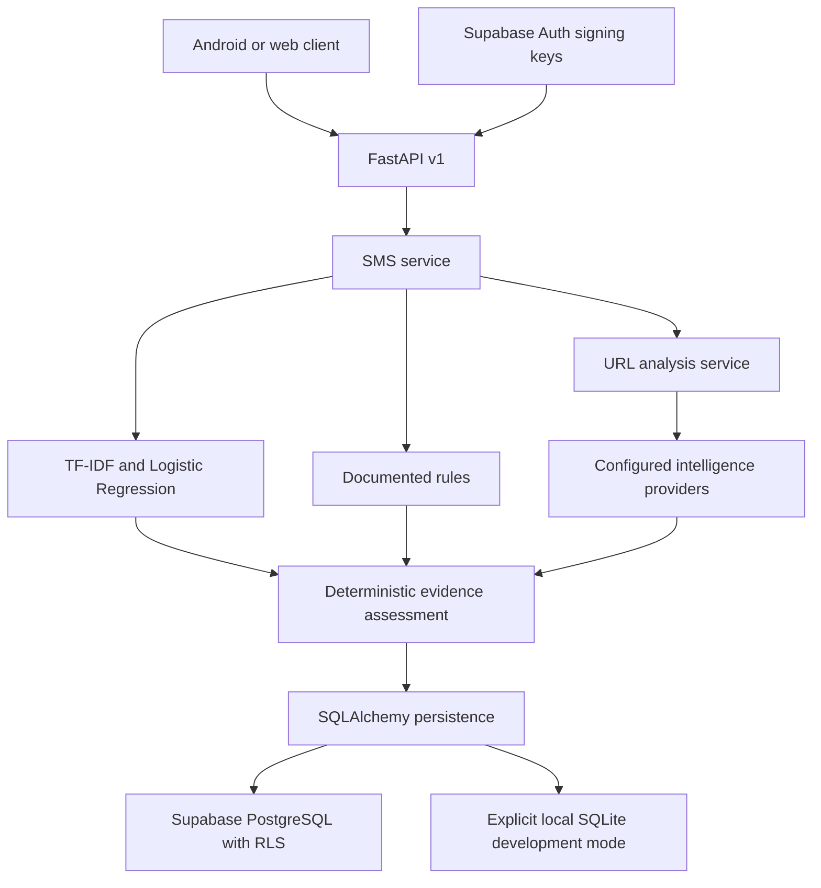

# Architecture

The first implementation uses a modular FastAPI application under `backend/app/`.
HTTP requests pass through limits and validation, JWT verification, services,
deterministic evidence assessment, and a SQLAlchemy transaction. Pydantic models
define both inputs and outputs. Services contain no seeded incidents or users.

SQLite is a local development and automated-test option, not a substitute claim
that Supabase is connected. Production uses PostgreSQL with TLS, a restricted
database role, JWT subject context, RLS, and application ownership filters.
Schema changes use versioned, checksum-checked migrations. No records are seeded.

Analysis commits authorization, device ownership and a shared quota in a short
transaction, releases the connection while running models/providers, then
commits a separate complete evidence/result transaction before HTTP success.
History reads/deletes use short owner-scoped transactions. This prevents optional
network waits from holding SQLite write locks or PostgreSQL idle transactions.

SMS training is offline. Dataset provenance, preprocessing, split identifiers,
evaluation, dependency versions, and artifact hashes accompany the model.
The historical spam task is distinct from Indian financial-fraud detection.
Unavailable models/providers return explicit statuses. Critical risk decisions
do not call an LLM. Raw messages and authentication tokens are excluded from logs.

The schema reserves the requested investigation, identity, evidence, model,
provider, graph, APK, QR, caller, report, watchlist, and alert entities. Reserved
tables do not mean their corresponding features are implemented. LangGraph and
verified visual brand references remain later phases. QR decoding runs in a
bounded temporary child process; caller investigations validate masked format
only. APK guards are implemented, but genuine Androguard parsing is unverified.

Gemini is an optional owner-authorized evidence-reference selector. It receives
only existing finding descriptions/IDs and deterministic recommendations, then
returns allowed references through a strict Pydantic schema. It cannot replace
evidence, create relationships or change risk assessment. Events record the
actual availability/validation status. Live Gemini communication is unverified.

Raw-URL inference is connected to URL, SMS and QR services. Feature extraction
uses locally reproducible URL text only. Original PhiUSIIL acquisition and
RF/XGBoost comparison code require the actual corpus and optional training
dependency; neither model is trained here. Missing artifacts produce an explicit
model_not_trained result.

Correlation stores information-level observations from existing URL records and connects directly shared URL hashes/exact hostnames through evidence-backed NetworkX paths. Its API uses ownership filtering, bounded results and a single database transaction. Graph identities are reused; deletion/retention prune unsupported nodes. Original risk stays unchanged. See CORRELATION.md.
